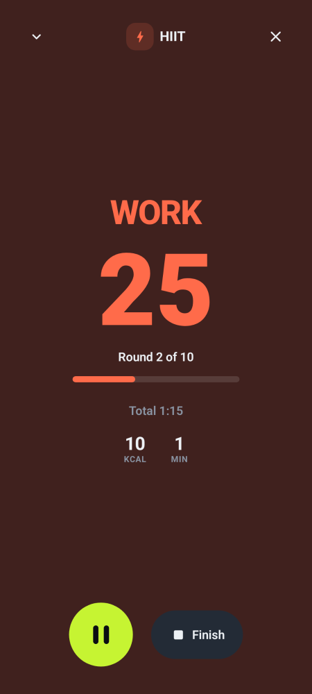
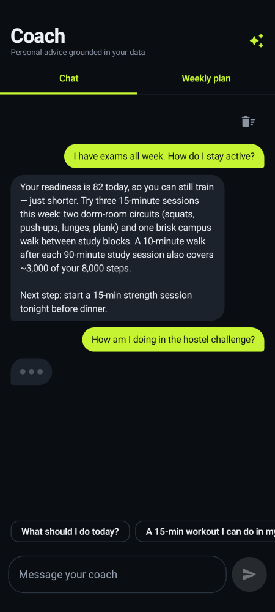
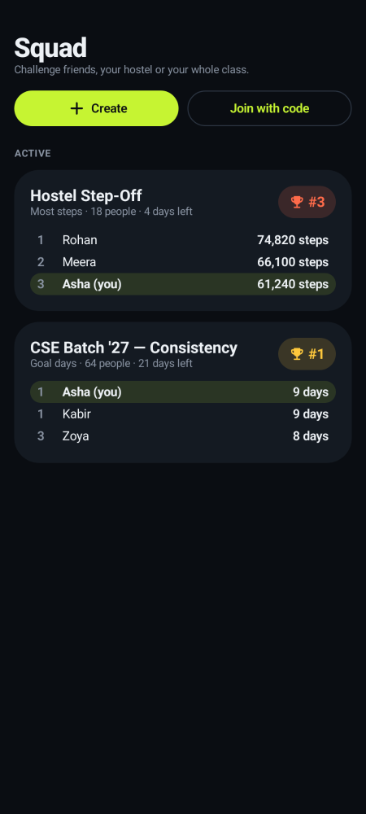
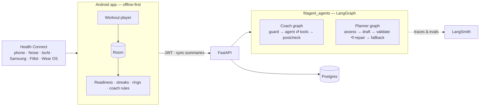

# FitAgent — an AI fitness coach for students

> **Problem statement:** *Student Innovation — ideas that can boost fitness activities and assist in keeping fit.*

Most students *want* to be active but lose momentum: exams, irregular sleep, no idea what to do today, and
fitness apps that either drown them in charts or shame them for missing a day. FitAgent answers one question
every morning — **"push, steady or recover?"** — and turns the answer into a concrete action, then keeps
students coming back with streaks, achievements and friendly campus challenges.

| | |
|---|---|
| **Readiness score** | One 0–100 number from last night's sleep, resting heart rate vs. *your own* 14-day baseline, and training load (acute:chronic ratio). Tap "Why?" for the breakdown. |
| **Today's coach** | A specific suggestion ("20-min HIIT", "18 more minutes of brisk walking closes your ring") with a one-tap Start button. |
| **Goal rings** | Steps, active kcal, workout minutes — de-duplicated from phone + watch via Health Connect. |
| **Workout player** | Live timer, HIIT interval presets (Tabata/Classic/Endurance) with full-screen colour phases and haptics; survives the app being killed; writes sessions back to Health Connect. |
| **Healthy streaks** | One missed day per week is absorbed by a *rest-day freeze* — consistency without burnout. 12 achievements with visible progress. |
| **AI coach (LangGraph)** | Chat grounded in your real data via tools, plus a 7-day plan that is **validated against safety rules** and repaired or replaced if the model breaks them. |
| **Squad challenges** | Create a challenge, share a 6-letter code, compete on steps, workout minutes or **goal days** (so beginners can win on consistency). |
| **Privacy first** | Works fully offline with no account. Cloud is opt-in; account deletion erases everything. |

<p align="center">
  
  
  
  
</p>

*(Screenshots are generated from the real Compose screens by the Paparazzi tests and double as visual regression tests.)*

---

## Architecture

```
fitagent/
├── app/        Android · Kotlin · Jetpack Compose · Room · WorkManager · Health Connect · Retrofit
├── backend/    Python · FastAPI · SQLAlchemy 2 (async) · Alembic · JWT · Postgres (SQLite for dev)
├── agents/     Python · LangGraph · LangChain · LangSmith tracing + evals
├── docs/       IMPLEMENTATION_PLAN.md (audit, design research, decisions)
└── docker-compose.yml
```



**Design decisions**

- **Offline-first.** Rings, readiness, streaks, workout tracking and reminders are computed on the phone. The
  backend adds accounts, cloud sync, challenges and the LLM coach; the app never breaks when it's unreachable.
- **Health Connect aggregates, not raw records** — the platform merges overlapping sources, so phone + watch
  steps are never double-counted.
- **Deterministic core, LLM on top.** Readiness, load and plan safety are pure functions (implemented identically
  in Kotlin and Python and unit-tested on both sides). The LLM explains and personalises; a validator enforces
  the rules. With no API key — or if the provider is down — every endpoint still works using the rule engine.
- **Safety guard before the model.** Messages about chest pain, fainting, injuries, disordered eating or self-harm
  never reach the LLM; the user gets a fixed, safe response with helplines. A post-check blocks diagnostic language.

### Agents

| Graph | Nodes | Notes |
|---|---|---|
| **Coach chat** | `guard → load_context → agent ⇄ tools → postcheck` | 5 read-only tools (`get_daily_activity`, `get_workouts`, `get_readiness_and_suggestion`, `get_goals_and_streak`, `get_challenges`) read the caller's data from graph state, so a model can never see another user's data. |
| **Weekly planner** | `load_context → assess → draft → validate ⟲ draft (≤3) → fallback` | Structured output (`WeeklyPlan`). Rules: ≥1 rest day, no back-to-back hard days, ≤3 hard days, ≤ last week + 15 % (floor 150 min, WHO), easy start when readiness is low. |

**Model:** provider-agnostic via `init_chat_model` — set `FITAGENT_MODEL` (default
`anthropic:claude-sonnet-5-5`; `openai:…` and `google_genai:…` work with the matching extra installed).

**LangSmith:** set `LANGSMITH_API_KEY` and every run is traced (user ids are hashed). Deterministic steps are
`@traceable`, so a trace shows the rules that shaped each answer. The eval suite (`agents/evals/`) has 8 coach
and 3 planner scenarios with 7 evaluators — safety routing, no-diagnosis, on-topic, actionable, concise,
grounded numbers, plan safety:

```bash
cd agents
uv run python -m evals.run_evals --offline   # local scorecard (CI runs this)
uv run python -m evals.run_evals             # upload an experiment to LangSmith
```

---

## Quick start

### 1. Backend + agents

```bash
cd fitagent
cp .env.example .env            # set SECRET_KEY, POSTGRES_PASSWORD; optionally ANTHROPIC_API_KEY, LANGSMITH_API_KEY
docker compose up -d --build    # Postgres + API (runs migrations on start)
curl localhost:8000/health
uv run python backend/scripts/smoke_test.py http://localhost:8000   # end-to-end check
```

Local development without Docker (SQLite, auto-created tables, docs at `/docs`):

```bash
uv sync --all-packages
cd backend && uv run uvicorn app.main:app --reload
```

### 2. Android app

Requires JDK 17 and the Android SDK (platform 34).

```bash
cd fitagent/app
./gradlew assembleDebug                      # app at build/outputs/apk/debug/
adb install -r build/outputs/apk/debug/FitAgent-debug.apk
```

The debug build talks to `http://10.0.2.2:8000/` (your computer, from the emulator). On a real phone, open
**You → Cloud account → Server** and enter your computer's LAN address, e.g. `http://192.168.1.20:8000/`.
Release builds are HTTPS-only; set the default with `-Pfitagent.apiUrl=https://api.example.com/` and sign them
with a `keystore.properties` file (`storeFile`, `storePassword`, `keyAlias`, `keyPassword`).

**Using a watch (Noise, boAt, Samsung, Fitbit, Wear OS):** pair it with its own app, enable *Health Connect*
sharing in that app, then tap **Connect** in FitAgent.

---

## API

Interactive docs at `/docs` in development. All `/v1` routes except auth need `Authorization: Bearer <access>`.

| Method | Path | Purpose |
|---|---|---|
| `POST` | `/v1/auth/register` · `/login` · `/refresh` | Accounts; argon2 hashing, 30-min access + 30-day refresh JWTs |
| `POST` | `/v1/auth/logout-all` | Revoke every token for the account |
| `GET` `PATCH` `DELETE` | `/v1/me` | Profile & goals; DELETE erases the account and all data |
| `POST` | `/v1/me/sync` | Idempotent upsert of daily summaries + workouts (+ deletions) |
| `GET` | `/v1/me/activity` · `/v1/me/workouts` | Synced history |
| `POST` | `/v1/coach/chat` | One coach turn (`reply`, `safety`, `tools_used`, `ai_powered`) |
| `GET` `DELETE` | `/v1/coach/messages` | Conversation history |
| `POST` `GET` | `/v1/coach/plan` | Generate / fetch the 7-day plan |
| `GET` `POST` | `/v1/challenges` | List mine / create |
| `POST` | `/v1/challenges/join` | Join by code |
| `GET` | `/v1/challenges/{id}` | Leaderboard |
| `DELETE` | `/v1/challenges/{id}/membership` | Leave (owner leaving deletes it) |

Rate limits: auth 10/min per IP, coach chat 15/min and plans 10/hour per user (in-process; put a gateway
limiter in front when running several API replicas).

---

## Testing

| Suite | Command | What it covers |
|---|---|---|
| Agents | `cd agents && uv run pytest` | Metrics, safety rules, fallback plans (every goal × readiness × weekday), both graphs with scripted fake models: tool calls, repair loop, fallback, safety short-circuit, diagnosis post-check |
| Evals | `uv run python -m evals.run_evals --offline` | Behavioural scorecard (also runs against a real model when a key is set) |
| Backend | `cd backend && uv run pytest` | Auth/refresh/revocation, rate limits, validation, sync idempotency, user isolation, challenges & ranking, coach + plan, LLM-outage fallback, account erasure |
| Migrations | `alembic upgrade head && alembic check` | Models and migrations never drift |
| Android | `./gradlew testDebugUnitTest verifyPaparazziDebug lintDebug` | Domain logic (readiness, streak freezes, calories, intervals, suggestions) + screenshot regression of 11 screens |
| End-to-end | `backend/scripts/smoke_test.py` | Full user journey against a running stack |

CI: `.github/workflows/fitagent.yml` runs all of the above plus the Docker build.

---

## Safety & privacy

FitAgent is a **fitness coach, not a medical device**. It never diagnoses, and red-flag messages are routed to
fixed guidance with helplines (Tele-MANAS 14416, iCall, 988, local emergency numbers). Health data is excluded
from Android backups, the app works without an account, cloud data is limited to daily summaries, and users
can erase their account in one tap. See the in-app privacy policy (`PrivacyPolicyActivity`).

### Design references

The UI direction came from public design analyses: WHOOP's single-score recovery model and progressive
disclosure ([925 Studios breakdown](https://www.925studios.co/blog/whoop-design-breakdown)), readiness dashboards
that reduce data fatigue ([Uxcel showcase](https://app.uxcel.com/showcase/personal-wellness-dashboard-095)), Nike
Training Club's workout player ([Pratt IxD critique](https://ixd.prattsi.org/2023/09/design-critique-nike-training-club-iphone-app/)),
and fitness-gamification guidance on streak pressure and team-based leaderboards
([RevenueCat guide](https://www.revenuecat.com/blog/growth/gamification-in-apps-complete-guide)).
