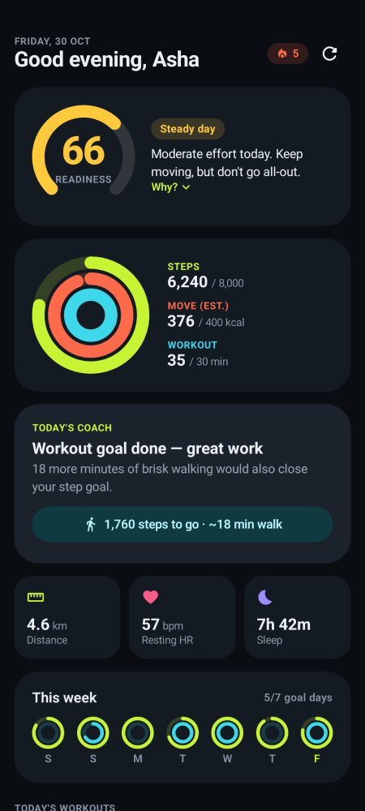
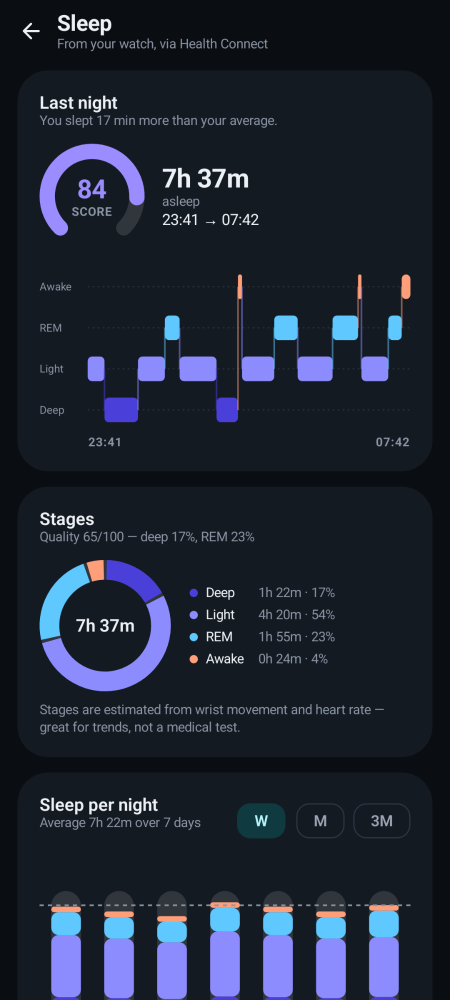
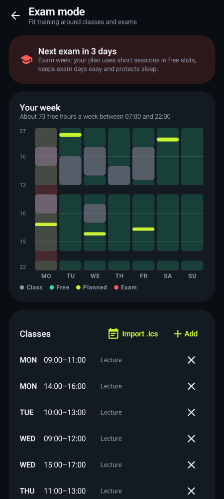
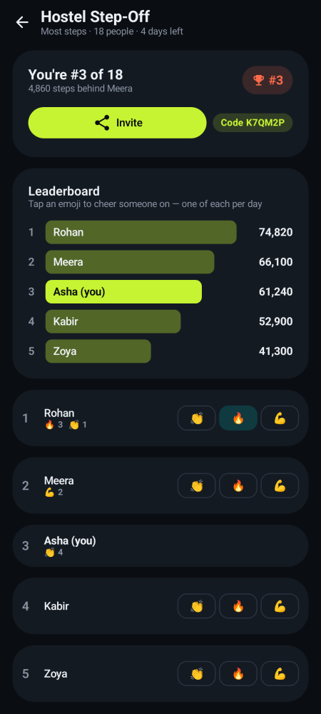
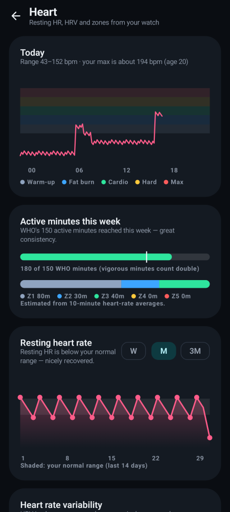
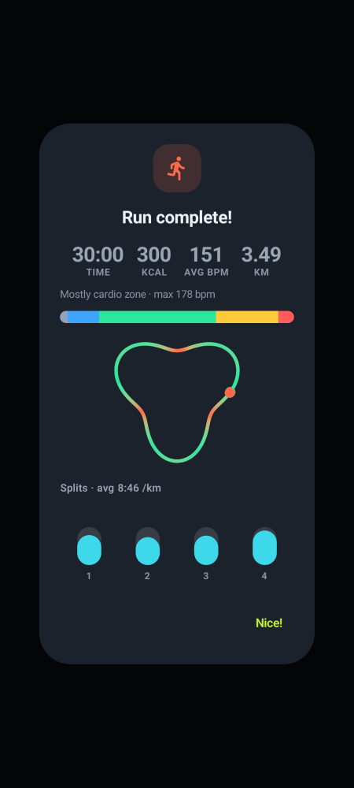
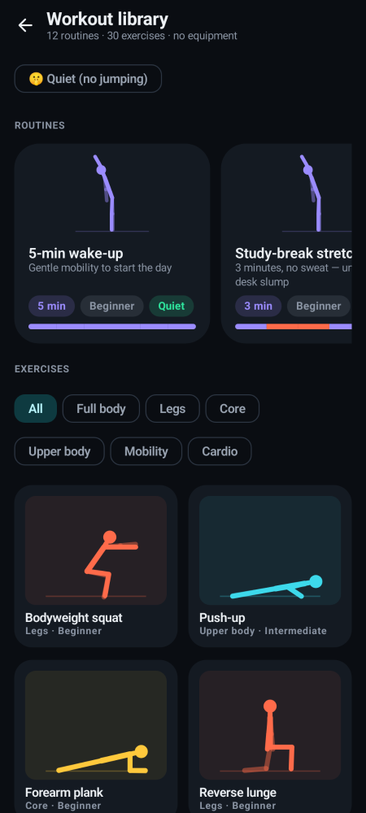
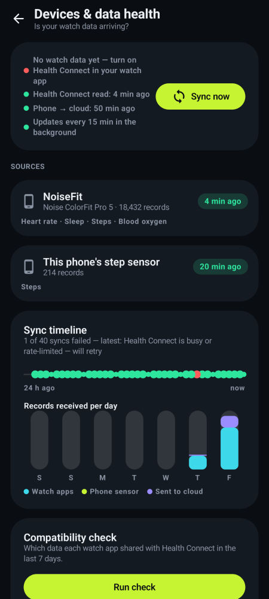
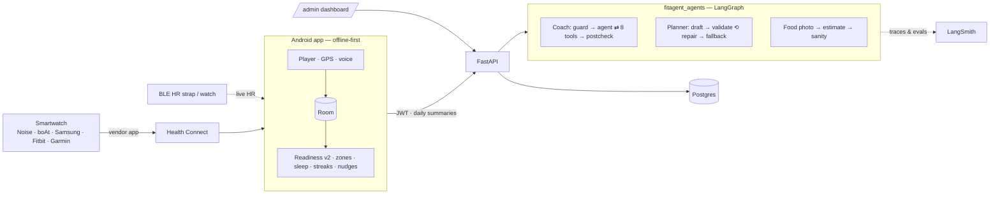

# FitAgent — an AI fitness coach for students

> **Problem statement:** *Student Innovation — ideas that can boost fitness activities and assist in keeping fit.*

Most students *want* to be active but lose momentum: exams, irregular sleep, no idea what to do today, and
fitness apps that either drown them in charts or shame them for missing a day. FitAgent turns the data their
**smartwatch** already collects into one daily answer — **"push, steady or recover?"** — then a concrete action,
plans that fit around classes and exams, and friendly campus competition to keep them coming back.

<p align="center">
  
  
  
  
</p>
<p align="center">
  
  
  
  
</p>

*Screenshots are rendered from the real Compose screens by the Paparazzi tests and double as visual regression tests.*

## What it does

| Area | Features |
|---|---|
| **Watch data** | Steps, distance, calories, floors, heart rate, resting HR, **HRV**, **SpO₂**, breathing rate, skin temperature, **sleep stages**, VO₂ max and workouts — from any watch whose app shares with Health Connect (NoiseFit, boAt Crest, Samsung Health, Fitbit, Garmin, Zepp…). Phone step sensor as a fallback. **Devices & data health** shows which watch delivered what and when; a **compatibility check** shows exactly what each watch app shares. Live heart rate from Bluetooth straps/watches in the player. |
| **Readiness v2** | One 0–100 score from sleep, sleep quality, HRV and resting HR vs *your own* baseline, overnight signals and training load — with safety caps (fever-like signals, < 4 h sleep, load spikes). Identical in Kotlin and Python. |
| **Charts everywhere** | 21-component in-house chart kit (scrub to read, personal-range bands, a plain-language headline on every chart): hypnogram, zone bands, calendar heatmaps, polar clock, race bars, route trace… |
| **Training** | Workout player (intervals, voice cues, live HR + zones, GPS route with km splits), **dorm workout library** (animated exercises, 12 guided routines, quiet/no-jump filter), WHO active minutes, workout mix. |
| **Student life** | **Exam mode**: timetable (or `.ics` import) + exam dates → plans that use free slots, go easy on exam days and protect sleep. Study-break nudges; bedtime reminder from tomorrow's first class. |
| **Wellbeing** | Mood check-in, stress estimate from heart rate at rest, guided breathing, helplines after a run of low days. Food log with photo estimates (Indian hostel food) and a protein goal — never calorie limits. |
| **AI coach** | LangGraph chat grounded in your data via 8 tools; 7-day planner validated against safety + exam rules; replies in English, हिन्दी and 4 more languages; red-flag messages (chest pain, self-harm, disordered eating, injury) never reach the model. |
| **Motivation** | Streaks with rest-day freezes, achievements, challenges with kudos and invite links, **campus leaderboards** (hostel/college/batch, per-capita), **rewards** for sensor-tracked goal days redeemable for partner perks, weekly recap image, home-screen widget. |
| **For colleges** | `/admin` dashboard — participation, hostel heatmap, steps histogram — aggregates only, never below 10 students; official campus challenges and perks. |
| **Privacy** | Works offline without an account. Intraday heart rate, sleep stages, GPS routes, mood and food stay on the phone; only daily summaries sync. One-tap account erasure. |

Feature-by-feature status: [docs/phase2/STATUS.md](docs/phase2/STATUS.md) · phone test plan: [docs/TESTING.md](docs/TESTING.md).

---

## Architecture

```
fitagent/
├── app/        Android · Kotlin · Compose · Room · WorkManager · Health Connect 1.1 · Glance · Retrofit
├── backend/    Python · FastAPI · SQLAlchemy 2 (async) · Alembic · JWT · Postgres (SQLite for dev)
├── agents/     Python · LangGraph · LangChain · LangSmith tracing + evals
├── fixtures/   readiness_v2.json — shared Kotlin/Python test cases
├── docs/       IMPLEMENTATION_PLAN.md (Phase 1) · phase2/ (specs, STATUS) · TESTING.md · DEVICE_TEST_MATRIX.md
└── docker-compose.yml
```



**Design decisions**
- **Watch data via Health Connect.** Noise/boAt and most brands use closed Bluetooth protocols; their apps write to
  Health Connect, which FitAgent reads (aggregates for steps so phone + watch never double-count). Changes API polling
  records which app delivered what. Details: [docs/phase2/03-watch-data-and-sync.md](docs/phase2/03-watch-data-and-sync.md).
- **Deterministic core, LLM on top.** Scores, zones, plan safety rules and every chart headline are pure, unit-tested
  functions; the LLM explains and personalises. Without an API key every feature still works on rules.
- **Safety before the model** (English + Hindi red flags) and a post-check against diagnostic language.

### Agents

| Graph | Nodes | Notes |
|---|---|---|
| **Coach chat** | `guard → load_context → agent ⇄ tools → postcheck` | Tools read only the caller's data: daily activity, workouts, readiness, goals & streak, challenges, **sleep detail**, **heart summary** (personal normal ranges), **trends**. |
| **Weekly planner** | `load_context → assess → draft → validate ⟲ draft (≤3) → fallback` | Rest day, no back-to-back hard days, ≤ +15 %/week; **Exam mode**: sessions inside free slots, ≤ 30 min in exam weeks, exam days easy, finish ≥ 2 h before bedtime. |
| **Food estimate** | `guard → vision model → sanity` | Structured dishes/portions/macros; disordered-eating notes get support, not numbers; totals capped. |

Model: `FITAGENT_MODEL` (default `anthropic:claude-sonnet-5-5`). LangSmith: set `LANGSMITH_API_KEY`; deterministic
steps are `@traceable`. Evals: 10 coach scenarios (incl. Hindi) × 7 evaluators + 3 planner scenarios.

```bash
cd agents
uv run python -m evals.run_evals --offline   # local scorecard (CI runs this)
uv run python -m evals.run_evals             # experiment in LangSmith
```

---

## Quick start

### 1. Backend + agents
```bash
cd fitagent
cp .env.example .env            # SECRET_KEY, POSTGRES_PASSWORD; optional ANTHROPIC_API_KEY, LANGSMITH_API_KEY
docker compose up -d --build    # Postgres + API (runs migrations on start); port from API_PORT (default 8000)
uv run python backend/scripts/smoke_test.py http://localhost:8000   # 19 end-to-end checks
```
Development without Docker (SQLite, docs at `/docs`): `uv sync --all-packages && cd backend && uv run uvicorn app.main:app --reload`.
`fitagent/.env` is loaded automatically by the backend and the evals.

Make a college admin, then open `/admin`:
```bash
docker compose exec api python scripts/make_admin.py admin@college.edu "College Name"
```

### 2. Android app
Requires JDK 17 and the Android SDK (platform 35).
```bash
cd fitagent/app
./gradlew assembleDebug
adb install -r build/outputs/apk/debug/FitAgent-debug.apk
```
On a phone, set **You → Cloud account → Server** to your computer's LAN address (e.g. `http://192.168.1.20:8000/`).
Release: `-Pfitagent.apiUrl=https://api.example.com/`, `-Pfitagent.inviteHost=example.com`, a `keystore.properties`
for signing, and `ANDROID_CERT_SHA256` on the server so invite links open the app (App Links).

**Watches:** pair the watch with its own app, turn on *Health Connect* sharing there, tap **Connect** in FitAgent,
then run **You → Data health → Compatibility check** to see exactly what arrives.

---

## API

All `/v1` routes except auth need `Authorization: Bearer <access>`. Interactive docs at `/docs` in development.

| Method | Path | Purpose |
|---|---|---|
| `POST` | `/v1/auth/register` · `/login` · `/refresh` · `/logout-all` | Accounts (argon2, 30-min access + 30-day refresh JWTs) |
| `GET` `PATCH` `DELETE` | `/v1/me` | Profile, goals, campus groups, coach language; DELETE erases everything |
| `POST` / `GET` | `/v1/me/sync` · `/v1/me/sync/status` | Idempotent upsert of daily summaries (incl. watch metrics) + workouts (incl. HR zones) |
| `GET` | `/v1/me/activity` · `/v1/me/workouts` | Synced history |
| `GET` `PUT` | `/v1/me/schedule` | Exam mode: free slots, exam dates, bedtime (no class names) |
| `POST` / `GET` `DELETE` | `/v1/coach/chat` · `/v1/coach/messages` | Coach turn / history |
| `POST` `GET` | `/v1/coach/plan` | Generate / fetch the 7-day plan |
| `POST` | `/v1/food/estimate` | Meal photo (base64, ≤ 4 MB) → estimate; never stored |
| `GET` `POST` | `/v1/challenges` · `/join` · `/{id}` · `/official` | Challenges, leaderboards, college challenges |
| `POST` `DELETE` | `/v1/challenges/{id}/kudos` | Reactions |
| `GET` | `/v1/campus/leaderboard?scope=hostel\|college\|batch` | Per-capita group ranking |
| `GET` / `POST` | `/v1/rewards` · `/v1/rewards/redeem` | Points, perks, codes |
| `GET` `POST` `PATCH` | `/v1/admin/overview` · `/challenges` · `/perks` | College admin (role-scoped, k ≥ 10) |
| `GET` | `/j/{code}` · `/.well-known/assetlinks.json` · `/admin` | Invite page, App Links, admin dashboard |

Rate limits: auth 10/min/IP, coach 15/min, plans 10/h, food 20/h, kudos 60/h, redeem 10/h (in-process).

---

## Testing

| Suite | Command | Covers |
|---|---|---|
| Agents | `uv run pytest agents` | Metrics, Readiness v2 + shared fixtures, safety (EN/HI), Exam-mode plans (45 timetable combos), tools, graphs, food guard, Hindi |
| Evals | `uv run python -m evals.run_evals --offline` | Behavioural scorecard incl. language match |
| Backend | `cd backend && uv run pytest` | Auth, sync + watch metrics, schedule, kudos, campus k-anonymity, rewards, admin scoping, food endpoint, erasure |
| Migrations | `alembic upgrade head && alembic check` | Models and migrations never drift |
| Android | `./gradlew testDebugUnitTest verifyPaparazziDebug lintDebug` | Domain logic (readiness parity, sleep, zones, routes, BLE parser, nudges, timetable/ICS, food, library) + screenshots |
| End-to-end | `backend/scripts/smoke_test.py <url>` | 19 checks on Postgres incl. every Phase 2 flow |
| On a phone | [docs/TESTING.md](docs/TESTING.md) | Manual plan A–I, watch data first |

CI (`.github/workflows/fitagent.yml`) runs every automated suite, regenerates the shared fixtures to catch drift, and
runs the smoke test against `docker compose`.

---

## Safety & privacy

FitAgent is a **fitness coach, not a medical device**: it never diagnoses, stress and sleep stages are labelled as
estimates, and red-flag messages (English and Hindi) get fixed guidance with helplines (Tele-MANAS 14416, iCall,
112/988). It never sets calorie limits. Health data is excluded from backups; intraday detail, routes, mood and food
stay on the phone; college admins see only aggregates of 10+ students; accounts erase in one tap.

### Design references
WHOOP's single-score recovery model ([925 Studios](https://www.925studios.co/blog/whoop-design-breakdown)),
readiness dashboards ([Uxcel](https://app.uxcel.com/showcase/personal-wellness-dashboard-095)), Nike Training Club's
player ([Pratt IxD](https://ixd.prattsi.org/2023/09/design-critique-nike-training-club-iphone-app/)), gamification
without streak pressure ([RevenueCat](https://www.revenuecat.com/blog/growth/gamification-in-apps-complete-guide)),
Dribbble fitness/sleep dashboards and research on sleep and heart-rate visualisation — see
[docs/phase2/01-design-and-charts.md](docs/phase2/01-design-and-charts.md).
